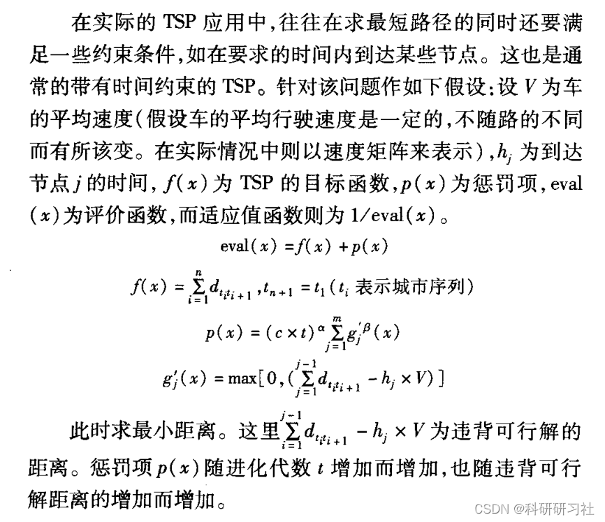
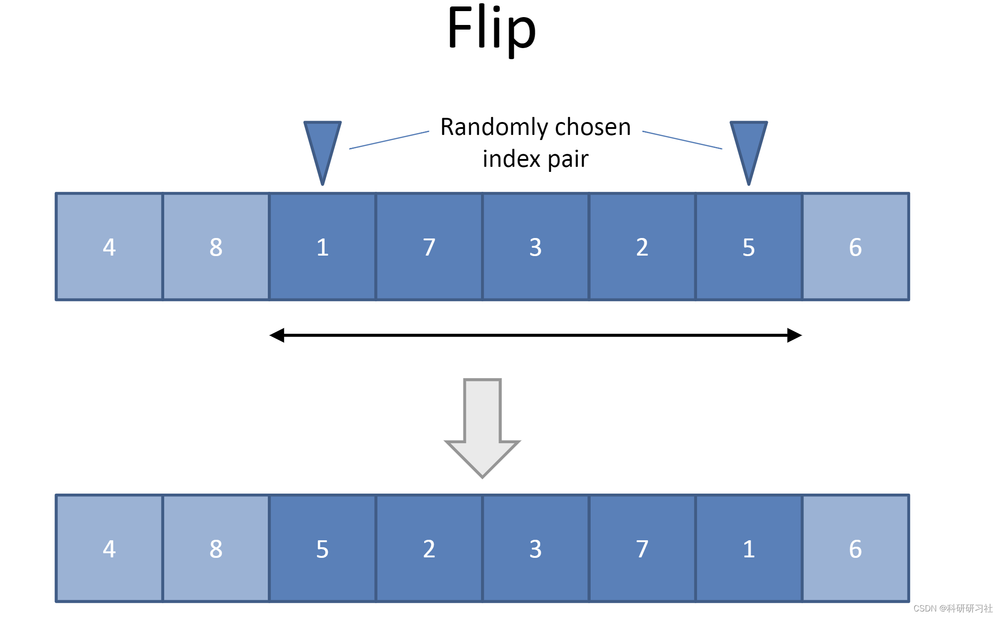
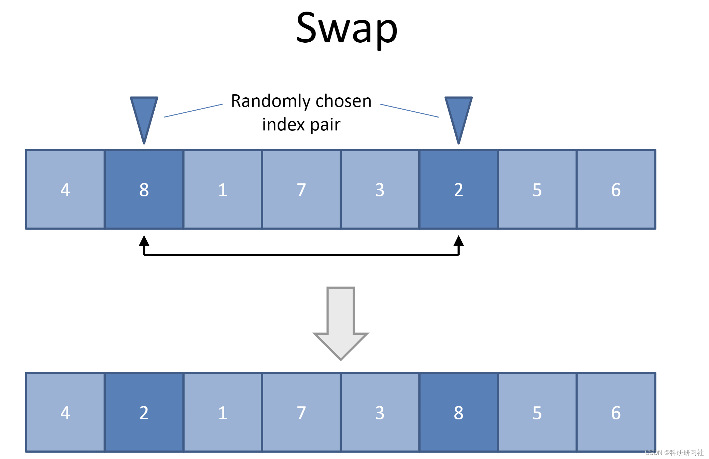
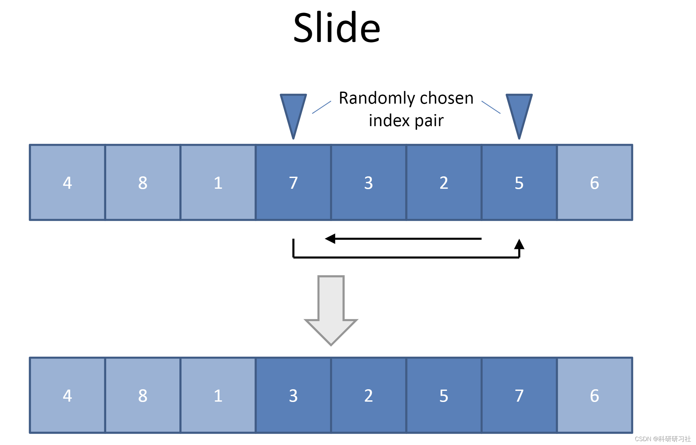
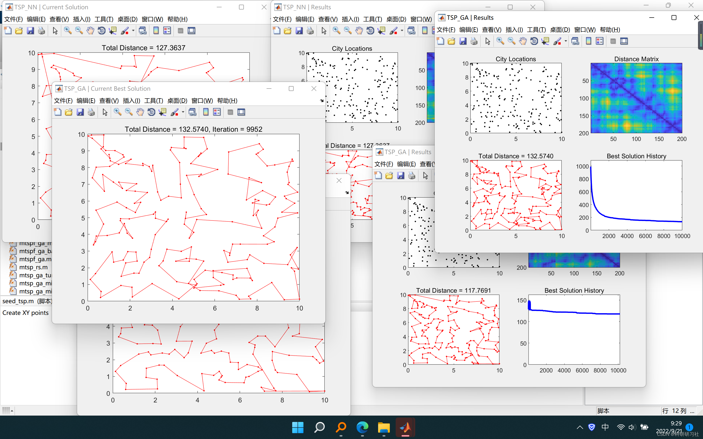
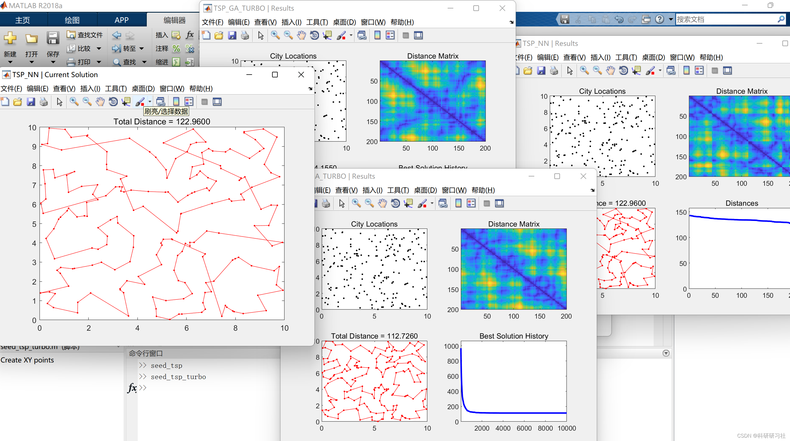

# Improved Genetic Algorithm for TSP/MTSP [Traveling Salesman Problem (TSP), Multi-Traveling Salesman Problem (M-TSP)] (Matlab

1. Overview of the main research on using genetic algorithms to solve TSP with constraints. The basic genetic algorithm is improved by combining greedy crossover operator, adaptive mutation operator, and selection operator with elite preservation strategy. The application of penalty method in genetic algorithms for real-world TSP is discussed, proposing an adaptive penalty function and integrating it with the improved genetic algorithm to solve TSP with time constraints. Comparative analysis of experimental results proves the feasibility and effectiveness of this method.
2. Traveling Salesman Problem (TSP)
3. Genetic Algorithms
Genetic algorithms were proposed by Professor John Holland in 1975. It borrows from the principles of simulation biological genetics and natural selection, enhancing the adaptability of individuals through mechanisms such as natural selection, crossover, and mutation. The genetic operations in the evolutionary process of genetic algorithms are random; however, the characteristics they exhibit are not entirely random. They can effectively utilize historical information to improve the performance of the next generation population, continuously evolving over generations until they converge to a solution space that is not necessarily optimal but is very close to the optimal solution. Genetic algorithms involve five key elements: encoding methods, initial population, fitness function, genetic operators, and control parameters.
Although the basic genetic algorithm has global search capabilities, it often encounters slow convergence or non-convergence during evolution, or falls into local optima. Enhancing convergence speed may lead to premature convergence, while overly fast convergence may result in suboptimal solutions. Therefore, scholars have conducted extensive research in these areas, hoping to accelerate convergence speed without causing premature convergence.
4. Constraint Optimization
5. Flowchart of Constraint Optimization with Penalty Method
6. Application of Penalty Function Genetic Algorithms in TSP
7. Route Reversal
8. Exchange of Two Cities in a Route
9.
1. Extract a city from the route and reinsert it into another location, dropping other cities
7. Run results 7.1 Single Traveling Salesman Problem (TSP) Edit
7.2 Multi-Traveling Salesman Problem (MTSP) Edit
8 Matlab Code Implementation: This document only showcases part of the code; for the complete code, click the link:
Based on Improved Genetic Algorithm to Solve TSP/MTSP [Traveling Salesman Problem (TSP), Multi-Traveling Salesman Problem (M-TSP)] (Matlab Code Implementation)
function varargout = mtspof_ga(varargin)\n    \n    \n    %\n    % Initialize default configuration\n    %\n    defaultConfig.xy          = 10*rand(40,2);\n    defaultConfig.dmat        = [];\n    defaultConfig.nSalesmen   = 5;\n    defaultConfig.minTour     = 1;\n    defaultConfig.popSize     = 80;\n    defaultConfig.numIter     = 5e3;\n    defaultConfig.showProg    = true;\n    defaultConfig.showStatus  = true;\n    defaultConfig.showResult  = true;\n    defaultConfig.showWaitbar = false;\n    \n    \n    %\n    % Interpret user configuration inputs\n    %\n    if ~nargin\n        userConfig = struct();\n    elseif isstruct(varargin{1})\n        userConfig = varargin{1};\n    else\n        try\n            userConfig = struct(varargin{:});\n        catch\n            error('??? Expected inputs are either a structure or parameter/value pairs');\n        end\n    end\n    \n    \n    %\n    % Override default configuration with user inputs\n    %\n    configStruct = get_config(defaultConfig,userConfig);\n    \n    \n    %\n    % Extract configuration\n    %\n    xy          = configStruct.xy;\n    dmat        = configStruct.dmat;\n    nSalesmen   = configStruct.nSalesmen;\n    minTour     = configStruct.minTour;\n    popSize     = configStruct.popSize;\n    numIter     = configStruct.numIter;\n    showProg    = configStruct.showProg;\n    showStatus  = configStruct.showStatus;\n    showResult  = configStruct.showResult;\n    showWaitbar = configStruct.showWaitbar;\n    if isempty(dmat)\n        nPoints = size(xy,1);\n        a = meshgrid(1:nPoints);\n        dmat = reshape(sqrt(sum((xy(a,:)-xy(a',:)).^2,2)),nPoints,nPoints);\n    end\n    \n    \n    %\n    % Verify inputs\n    %\n    [N,dims] = size(xy);\n    [nr,nc] = size(dmat);\n    if (N ~= nr) || (N ~= nc)\n        error('??? Invalid XY or DMAT inputs')\n    end\n    n = N - 2; % Separate start and end cities\n    \n    \n    %\n    % Sanity checks\n    %\n    nSalesmen   = max(1,min(n,round(real(nSalesmen(1)))));\n    minTour     = max(1,min(floor(n/nSalesmen),round(real(minTour(1)))));\n    popSize     = max(8,8*ceil(popSize(1)/8));\n    numIter     = max(1,round(real(numIter(1))));\n    showProg    = logical(showProg(1));\n    showStatus  = logical(showStatus(1));\n    showResult  = logical(showResult(1));\n    showWaitbar = logical(showWaitbar(1));\n    \n    \n    %\n    % Initializations for route break point selection\n    %\n    nBreaks = nSalesmen-1;\n    dof = n - minTour*nSalesmen;          % degrees of freedom\n    addto = ones(1,dof+1);\n    for k = 2:nBreaks\n        addto = cumsum(addto);\n    end\n    cumProb = cumsum(addto)/sum(addto);\n    \n    \n    %\n    % Initialize the populations\n    %\n    popRoute = zeros(popSize,n);         % population of routes\n    popBreak = zeros(popSize,nBreaks);   % population of breaks\n    popRoute(1,:) = (1:n) + 1;\n    popBreak(1,:) = rand_breaks();\n    for k = 2:popSize\n        popRoute(k,:) = randperm(n) + 1;\n        popBreak(k,:) = rand_breaks();\n    end\n    \n    \n    %\n    % Seed the algorithm with a previous result if available\n    %\n    if all(isfield(userConfig,{'optRoute','optBreak'}))\n        optRoute = userConfig.optRoute;\n        optBreak = userConfig.optBreak;\n        isValidRoute = isequal(popRoute(1,:),sort(optRoute));\n        isValidBreak = all(optBreak > 0) && all(optBreak <= n) && ...\n            (length(optBreak) == nBreaks) && ~any(mod(optBreak,1));\n        if isValidRoute && isValidBreak\n            popRoute(1,:) = optRoute;\n            popBreak(1,:) = optBreak;\n        end\n    end\n    \n    \n    %\n    % Select the colors for the plotted routes\n    %\n    pclr = ~get(0,'DefaultAxesColor');\n    clr = [1 0 0; 0 0 1; 0.67 0 1; 0 1 0; 1 0.5 0];\n    if (nSalesmen > 5)\n        clr = hsv(nSalesmen);\n    end\n    \n    \n    %\n    % Run the GA\n    %\n    row = zeros(popSize,n+nSalesmen);\n    col = zeros(popSize,n+nSalesmen);\n    isValid = false(1,n+nSalesmen);\n    globalMin = Inf;\n    distHistory = NaN(1,numIter);\n    tmpPopRoute = zeros(8,n);\n    tmpPopBreak = zeros(8,nBreaks);\n    newPopRoute = zeros(popSize,n);\n    newPopBreak = zeros(popSize,nBreaks);\n    [isClosed,isStopped,isCancelled] = deal(false);\n    if showProg\n        hFig = figure('Name','MTSPOF_GA | Current Best Solution', ...\n            'Numbertitle','off','CloseRequestFcn',@close_request);\n        hAx = gca;\n        if showStatus\n            [hStatus,isCancelled] = figstatus(0,numIter,[],hFig);\n        end\n    end\n    if showWaitbar\n        hWait = waitbar(0,'Searching for near-optimal solution ...', ...\n            'CreateCancelBtn',@cancel_search);\n    end\n    isRunning = true;\n    for iter = 1:numIter\n        \n        %\n        % EVALUATE SOLUTIONS\n        %   This section of code computes the total cost of each solution\n        %   in the population. The actual code that gets executed uses a\n        %   much faster (vectorized) method to calculate the route lengths\n        %   compared to the triple for-loop below (provided for reference)\n        %   but gives the same result.\n        %\n        %     totalDist = zeros(popSize,1);\n        %     for p = 1:popSize\n        %         d = 0;\n        %         pRoute = popRoute(p,:);\n        %         pBreak = popBreak(p,:);\n        %         rng = [[1 pBreak+1];[pBreak n]]';\n        %         for s = 1:nSalesmen\n        %             d = d + dmat(1,pRoute(rng(s,1)));\n        %             for k = rng(s,1):rng(s,2)-1\n        %                 d = d + dmat(pRoute(k),pRoute(k+1));\n        %             end\n        %             d = d + dmat(pRoute(rng(s,2)),N);\n        %         end\n        %         totalDist(p) = d;\n        %     end\n        %\n        for p = 1:popSize\n            brk = popBreak(p,:);\n            isValid(:) = false;\n            isValid([1 brk+(2:nSalesmen)]) = true;\n            row(p,isValid) = 1;\n            row(p,~isValid) = popRoute(p,:);\n            isValid(:) = false;\n            isValid([brk+(1:nSalesmen-1) n+nSalesmen]) = true;\n            col(p,isValid) = N;\n            col(p,~isValid) = popRoute(p,:);\n        end\n        ind = N*(col-1) + row;\n        totalDist = sum(dmat(ind),2);\n        \n        \n        %\n        % SELECT THE BEST\n        %   This section of code finds the best solution in the current\n        %   population and stores it if it is better than the previous best.\n        %\n        [minDist,index] = min(totalDist);\n        distHistory(iter) = minDist;\n        if (minDist < globalMin)\n            globalMin = minDist;\n            optRoute = popRoute(index,:);\n            optBreak = popBreak(index,:);\n            rng = [[1 optBreak+1];[optBreak n]]';\n            if showProg\n                \n                %\n                % Plot the best route\n                %\n                for s = 1:nSalesmen\n                    rte = [1 optRoute(rng(s,1):rng(s,2)) N];\n                    if (dims > 2), plot3(hAx,xy(rte,1),xy(rte,2),xy(rte,3),'.-','Color',clr(s,:));\n                    else, plot(hAx,xy(rte,1),xy(rte,2),'.-','Color',clr(s,:)); end\n                    hold(hAx,'on');\n                end\n                if (dims > 2), plot3(hAx,xy(1,1),xy(1,2),xy(1,3),'o','Color',pclr);\n                    plot3(hAx,xy(N,1),xy(N,2),xy(N,3),'o','Color',pclr);\n                else, plot(hAx,xy(1,1),xy(1,2),'o','Color',pclr);\n                    plot(hAx,xy(N,1),xy(N,2),'o','Color',pclr);\n                end\n                title(hAx,sprintf('Total Distance = %1.4f, Iteration = %d',minDist,iter));\n                hold(hAx,'off');\n                drawnow;\n            end\n        end\n        \n        \n        %\n        % Update the status bar and check cancellation status\n        %\n        if showProg && showStatus && ~mod(iter,ceil(numIter/100))\n            [hStatus,isCancelled] = figstatus(iter,numIter,hStatus,hFig);\n        end\n        if (isStopped || isCancelled)\n            break\n        end\n        \n        \n        %\n        % MODIFY THE POPULATION\n        %   This section of code invokes the genetic algorithm operators.\n        %   In this implementation, solutions are randomly assigned to groups\n        %   of eight and the best solution is kept (tournament selection).\n        %   The best-of-eight solution is then mutated 3 different ways\n        %   (flip, swap, and slide) and the four resulting solutions are\n        %   then copied but assigned different break points to complete the\n        %   group of eight. There is no crossover operator because it tends\n        %   to be highly destructive and rarely improves a decent solution.\n        %\n        randomOrder = randperm(popSize);\n        for p = 8:8:popSize\n            rtes = popRoute(randomOrder(p-7:p),:);\n            brks = popBreak(randomOrder(p-7:p),:);\n            dists = totalDist(randomOrder(p-7:p));\n            [ignore,idx] = min(dists); %#ok\n            bestOf8Route = rtes(idx,:);\n            bestOf8Break = brks(idx,:);\n            routeInsertionPoints = sort(randperm(n,2));\n            I = routeInsertionPoints(1);\n            J = routeInsertionPoints(2);\n            for k = 1:8 % Generate new solutions\n                tmpPopRoute(k,:) = bestOf8Route;\n                tmpPopBreak(k,:) = bestOf8Break;\n                switch k\n                    case 2 % Flip\n                        tmpPopRoute(k,I:J) = tmpPopRoute(k,J:-1:I);\n                    case 3 % Swap\n                        tmpPopRoute(k,[I J]) = tmpPopRoute(k,[J I]);\n                    case 4 % Slide\n                        tmpPopRoute(k,I:J) = tmpPopRoute(k,[I+1:J I]);\n                    case 5 % Modify breaks\n                        tmpPopBreak(k,:) = rand_breaks();\n                    case 6 % Flip, modify breaks\n                        tmpPopRoute(k,I:J) = tmpPopRoute(k,J:-1:I);\n                        tmpPopBreak(k,:) = rand_breaks();\n                    case 7 % Swap, modify breaks\n                        tmpPopRoute(k,[I J]) = tmpPopRoute(k,[J I]);\n                        tmpPopBreak(k,:) = rand_breaks();\n                    case 8 % Slide, modify breaks\n                        tmpPopRoute(k,I:J) = tmpPopRoute(k,[I+1:J I]);\n                        tmpPopBreak(k,:) = rand_breaks();\n                    otherwise % Do nothing\n                end\n            end\n            newPopRoute(p-7:p,:) = tmpPopRoute;\n            newPopBreak(p-7:p,:) = tmpPopBreak;\n        end\n        popRoute = newPopRoute;\n        popBreak = newPopBreak;\n        \n        \n        %\n        % Update the waitbar\n        %\n        if showWaitbar && ~mod(iter,ceil(numIter/325))\n            waitbar(iter/numIter,hWait);\n        end\n        \n    end\n    if showProg && showStatus\n        figstatus(numIter,numIter,hStatus,hFig);\n    end\n    if showWaitbar\n        delete(hWait);\n    end\n    isRunning = false;\n    if isClosed\n        delete(hFig);\n    end\n    \n    \n    %\n    % Append prior distance history if present\n    %\n    if isfield(userConfig,'distHistory')\n        priorHistory = userConfig.distHistory;\n        isNan = isnan(priorHistory);\n        distHistory = [priorHistory(~isNan) distHistory];\n    end\n    \n    \n    %\n    % Format the optimal solution\n    %\n    optSolution = cell(nSalesmen,1);\n    rng = [[1 optBreak+1];[optBreak n]]';\n    for s = 1:nSalesmen\n        optSolution{s} = [1 optRoute(rng(s,1):rng(s,2)) N];\n    end\n    \n    \n    %\n    % Show the final results\n    %\n    if showResult\n        \n        %\n        % Plot the GA results\n        %\n        figure('Name','MTSPOF_GA | Results','Numbertitle','off');\n        subplot(2,2,1);\n        if (dims > 2), plot3(xy(:,1),xy(:,2),xy(:,3),'.','Color',pclr);\n        else, plot(xy(:,1),xy(:,2),'.','Color',pclr); end\n        title('City Locations');\n        subplot(2,2,2);\n        imagesc(dmat([1 optRoute N],[1 optRoute N]));\n        title('Distance Matrix');\n        subplot(2,2,3);\n        for s = 1:nSalesmen\n            rte = optSolution{s};\n            if (dims > 2), plot3(xy(rte,1),xy(rte,2),xy(rte,3),'.-','Color',clr(s,:));\n            else, plot(xy(rte,1),xy(rte,2),'.-','Color',clr(s,:)); end\n            title(sprintf('Total Distance = %1.4f',minDist));\n            hold on;\n        end\n        if (dims > 2), plot3(xy(1,1),xy(1,2),xy(1,3),'o','Color',pclr);\n            plot3(xy(N,1),xy(N,2),xy(N,3),'o','Color',pclr);\n        else, plot(xy(1,1),xy(1,2),'o','Color',pclr);\n            plot(xy(N,1),xy(N,2),'o','Color',pclr);\n        end\n        subplot(2,2,4);\n        plot(distHistory,'b','LineWidth',2);\n        title('Best Solution History');\n        set(gca,'XLim',[1 length(distHistory)],'YLim',[0 1.1*max([1 distHistory])]);\n    end\n    \n    \n    %\n    % Return output\n    %\n    if nargout\n        \n        %\n        % Create anonymous functions for plot generation\n        %\n        plotPoints  = @(s)plot(s.xy(:,1),s.xy(:,2),'.','Color',~get(gca,'Color'));\n        plotResult  = @(s)cellfun(@(s,i)plot(s.xy(i,1),s.xy(i,2),'.-', ...\n            'Color',rand(1,3)),repmat({s},size(s.optSolution)),s.optSolution);\n        plotHistory = @(s)plot(s.distHistory,'b-','LineWidth',2);\n        plotMatrix  = @(s)imagesc(s.dmat(cat(2,s.optSolution{:}),cat(2,s.optSolution{:})));\n        \n        \n        %\n        % Save results in output structure\n        %\n        resultStruct = struct( ...\n            'xy',          xy, ...\n            'dmat',        dmat, ...\n            'nSalesmen',   nSalesmen, ...\n            'minTour',     minTour, ...\n            'popSize',     popSize, ...\n            'numIter',     numIter, ...\n            'showProg',    showProg, ...\n            'showResult',  showResult, ...\n            'showWaitbar', showWaitbar, ...\n            'optRoute',    optRoute, ...\n            'optBreak',    optBreak, ...\n            'optSolution', {optSolution}, ...\n            'plotPoints',  plotPoints, ...\n            'plotResult',  plotResult, ...\n            'plotHistory', plotHistory, ...\n            'plotMatrix',  plotMatrix, ...\n            'distHistory', distHistory, ...\n            'minDist',     minDist);\n        \n        varargout = {resultStruct};\n        \n    end\n    \n    \n    %\n    % Generate random set of break points\n    %\n    function breaks = rand_breaks()\n        if (minTour == 1) % No constraints on breaks\n            breaks = sort(randperm(n-1,nBreaks));\n        else % Force breaks to be at least the minimum tour length\n            nAdjust = find(rand < cumProb,1)-1;\n            spaces = randi(nBreaks,1,nAdjust);\n            adjust = zeros(1,nBreaks);\n            for kk = 1:nBreaks\n                adjust(kk) = sum(spaces == kk);\n            end\n            breaks = minTour*(1:nBreaks) + cumsum(adjust);\n        end\n    end\n    \n    \n    %\n    % Nested function to cancel search\n    %\n    function cancel_search(varargin)\n        isStopped = true;\n    end\n    \n    \n    %\n    % Nested function to close the figure window\n    %\n    function close_request(varargin)\n        if isRunning\n            [isClosed,isStopped] = deal(true);\n            isRunning = false;\n        else\n            delete(hFig);\n        end\n    end\n    \nend\n  
9. References [1] Jiang Tai, Chen Mingjun, Huang Yuan. Genetic Algorithm with Constraint Optimization for TSP Solving [J]. Computer Application Research, 2008, 25(5):1323-1325

## Images

<!-- PAYMENT_BLOCK -->

## Get this dataset

- Payment link (Stripe): [Buy now](https://buy.stripe.com/3cs8yP7sY87d0vu9AB)
- Payment QR code: 

<!-- /PAYMENT_BLOCK -->
